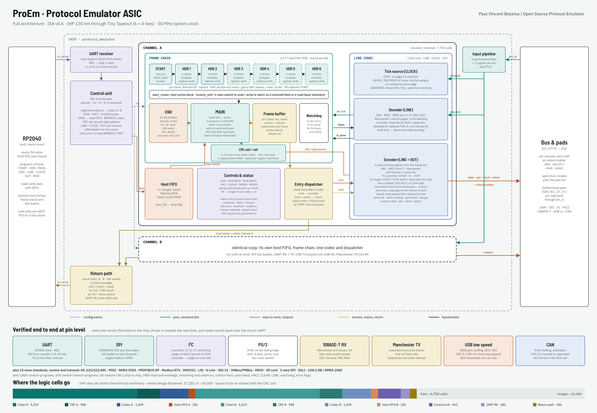

# ProEm - Open Source Protocol Emulator

ProEm is an open-source protocol emulator ASIC: a chip that lets an RP2040 speak many serial protocols through one piece of
hardware. The RP2040 describes a frame in a few instruction bytes; the chip runs it at up to one
bit per clock, with exact timing, and sends back what it received plus a status for every frame.

Target: IHP SG13CMOS5L 130 nm through [Tiny Tapeout](https://tinytapeout.com) (6 × 4 tiles, as the Jane Street challenge sets), 50 MHz.
Top module for Tiny Tapeout: `tt_um_vertrex_star_proem`.
Built for the [Jane Street protocol emulator ASIC competition](https://blog.janestreet.com/protocol-emulator-asic-competition/).



## At a glance

| | |
| --- | --- |
| Channels | 2 independent channels, A and B, running at the same time |
| Host link | UART in with auto-baud, UART out at a rate set by `LINK` (down to 4 clocks per bit) |
| Verified at pin level | UART, SPI (controller and target), I2C controller and target, PS/2, 10BASE-T receive, Manchester transmit, USB low speed receive and transmit with CRC-5/CRC-16 and handshake, SWD-style acknowledge handling, CAN with bit stuffing, arbitration, CRC-15 and acknowledge; plus RS-232/422/485, MIDI, NMEA 0183, PROFIBUS DP, Modbus RTU, DMX512, LIN, K-Line, SDI-12, SMBus/PMBus, MDIO, SD card (SPI), 3-wire SPI, DALI, CAN 2.0B / NMEA 2000 |
| Reacting on chip | `BRANCH` rules change a frame's direction, or abort it, from a field just received or from the line not reading back what the chip drove |
| CRC and reply on chip | Any CRC of 1 to 16 bits, checked on receive or appended on transmit; a fixed reply (USB ACK, CAN ACK slot) sent a set number of bits after a good or bad frame |
| Long packets | `DATA` streams while a frame runs; fixed-timing lines report an underrun if the data runs out |
| Logic | 15,513 cells after synthesis, 19,737 after place and route (35 % of the 6 × 4 core area), before the CRC unit; to be re-hardened |
| Timing | Closed after routing at all three corners on CMOS5L: 17.4 ns worst path at 1.08 V, 125 °C (20 ns budget) |
| Instruction set | ISA v0.6, see [docs/protocol_emulator_isa.pdf](docs/protocol_emulator_isa.pdf) |

## How it works

* **Host side.** A UART receiver with auto-baud feeds a control unit that decodes ISA
  instructions into registered configuration writes. A return path sends received data, a status
  per frame and link events back on a second UART.
* **Input pipeline.** Every input pin passes through two synchroniser flops and one register.
* **Two channels.** Each has a host FIFO for write data, a *frame chain* (START, up to six headers,
  MAIN, END, watchdog, frame buffer, a *branch unit* with two rules, and a *CRC unit* with a
  reply pattern), an entry dispatcher, and a
  *line codec*:
  * tick source: SYNC (clock pin edge), ASYNC / RECOVER (bit timer that re-centres on edges),
    GENERATE (drives SCK / SCL, with clock stretching);
  * decoder: NRZ, NRZI, NRZI on the USB pair, Manchester, bit unstuffing;
  * encoder: the same codes, stuff insertion, I2C START / Sr / STOP, USB end of packet,
    open drain, chip select;
  * I2C target support: START / STOP detection and SDA timing against an external SCL;
  * read-back check of the driven pad, for arbitration.

The [design reference](docs/protocol_emulator_design.pdf) explains every block and gives the exact
instruction bytes for each standard. The line codec, the most involved block, has its own
walk-through: [docs/line_codec.pdf](docs/line_codec.pdf). The
[standards programming guide](docs/standards_guide.pdf) gives tested receive and transmit
programs for fifteen more standards.

## Using the chip

A host (an RP2040, or a PC through a USB-UART adapter) drives ProEm over one serial line:

1. Connect the host's TX to `ui[0]` and RX to `uo[0]`. The protocol lines are `uio[0]` to
   `uio[2]` for channel A and `uio[3]` to `uio[5]` for channel B.
2. After reset, send `0x55` once; the chip learns the host's baud rate from it.
3. Program a channel: line coding, clock, pin drive, and the frame's shape (START, headers,
   MAIN, END). The settings stay until they are rewritten.
4. Queue the payload with `DATA` and start with `RUN`. Fixed parts of a frame (addresses,
   commands, sync patterns) come from the program; only the payload changes per frame.
5. Read the results on `uo[0]`: received data, and one status byte per frame.

[host/](host/README.md) has a Python library that builds the instruction bytes and decodes the
replies, with a worked UART transmit example. For example, sending `A0000` at 115200 baud on
channel A:

```python
import proem_host as ph
first, rest = ph.uart_tx(0, 115200, b"A0000")   # instruction bytes to send to ui[0]
```

New to the toolchain? [docs/beginners_guide.pdf](docs/beginners_guide.pdf) explains YAML, Icarus
Verilog, cocotb, the C++ tests, the ASIC flow, processes and Tiny Tapeout from the start.

## Repository layout

```
info.yaml           Tiny Tapeout project file: title, tiles, source list, pin names
src/
  top/              tt_um_vertrex_star_proem.sv  Tiny Tapeout top level (pin map)
                    protocol_emulator.sv         chip core
                    protocol_emulator_inst.sv    instantiation template
  core/             emulator_channel, control_unit, line_codec, entry_dispatch, return_path
    frame_chain/    frame_chain and its blocks (START, headers, router, MAIN, END, watchdog,
                    branch_unit, crc_unit)
  primitives/       uart_rx, uart_tx, host_fifo, frame_buffer
  files.f           file list in compile order
  config.json       LibreLane settings used by the Tiny Tapeout GDS flow
test/               cocotb test (tb.v, test.py), runs on RTL and on the gate-level netlist
sim/                pin-level test bench (bench.h) and one test per standard (t_*.cpp)
host/               Python host library (proem_host.py) and how to drive the chip
formal/             formal proofs (SymbiYosys): harnesses and .sby files
scripts/            run.sh (all tests + synthesis), sta.sh (timing check), formal.sh (all proofs)
gds/                the layout (GDS, LEF), layout images and a results summary
docs/               design reference and ISA spec, beginner's guide, formal verification guide
                    (PDF + LaTeX), architecture diagram, info.md (datasheet page), layout renders
  diagram/          diagram generator (make_diagram.py) and its fonts (SIL OFL)
.github/workflows/  gds (Tiny Tapeout GDS, precheck, gate-level test, viewer), test (cocotb),
                    docs (datasheet check), sim (every pin-level test), formal (every proof)
```

Module hierarchy:

```
tt_um_vertrex_star_proem                   src/top
└── protocol_emulator                      src/top
    ├── uart_rx                            src/primitives
    ├── control_unit                       src/core
    ├── emulator_channel (A and B)         src/core
    │   ├── host_fifo                      src/primitives
    │   ├── line_codec                     src/core
    │   ├── frame_chain                    src/core/frame_chain
    │   │   ├── first_counter, header_counter (x6), start_router
    │   │   ├── main_counter, end_counter, watchdog
    │   │   ├── branch_unit, crc_unit
    │   │   └── frame_buffer               src/primitives
    │   └── entry_dispatch                 src/core
    └── return_path                        src/core
        └── uart_tx                        src/primitives
```

Every file starts with a header: file, module, type (top level, core RTL or primitive), place in
the hierarchy, submodules, author, and a description line.

## Tiny Tapeout

The chip is packaged as a Tiny Tapeout project on the CMOS5L template (the `cmos5l` branch of
Tiny Tapeout's IHP template), as the Jane Street challenge asks (`info.yaml`, `src/config.json`,
top module `tt_um_vertrex_star_proem`). Every push runs the `gds` workflow, which builds the
layout for IHP SG13CMOS5L with LibreLane, runs the Tiny Tapeout precheck and the cocotb test on
the gate-level netlist, and publishes a 3D viewer. A green `gds` run is what the challenge
needs for a submission.

### Pin map

| Pin | Direction | Use |
| --- | --- | --- |
| `ui[0]` | in | RX: instructions from the host (the first byte after reset must be `0x55`) |
| `ui[7:1]` | in | unused |
| `uo[0]` | out | TX: data and status to the host |
| `uo[1]` | out | BAUD_LOCKED |
| `uo[3:2]` | out | ARMED for channels B and A |
| `uo[5:4]` | out | HOST_FULL for channels B and A |
| `uo[7:6]` | out | SELECT (chip select) for channels B and A |
| `uio[0]`, `uio[1]`, `uio[2]` | in/out | pins 0 to 2, driven by channel A: data (TX, MOSI, SDA, D+), pair (D-), clock (SCK, SCL) |
| `uio[3]`, `uio[4]`, `uio[5]` | in/out | pins 3 to 5, driven by channel B, same order |
| `uio[7:6]` | in | pins 6 and 7 |

The `PIN` fields in the instructions count the `uio` pads, and every pad is read back, so open-drain
lines (I2C, USB) work on a single pad. A channel only drives its pads when `OUT` enables them.

### Layout


The GDS file, pictures of the layout and a summary of space, power, performance and the Jane Street
challenge are in [gds/](gds/README.md).

Hardened locally with the same flow the `gds` workflow uses (template branch `cmos5l`,
LibreLane 3.1.0.dev3, IHP-Open-PDK at the commit the workflow installs), at the 6 × 4 tiles the
Jane Street challenge sets:

| | |
| --- | --- |
| Process | IHP SG13CMOS5L 130 nm |
| Tiles | 6 × 4, 1289.28 × 710.64 µm |
| Cells | 15,513 after synthesis; 19,737 after place and route, not counting fill (includes 3,266 hold buffers and 299 clock tree cells) |
| Utilisation | 35 % of the core area; the lower third of the die is free |
| Routing | 0 violations after detailed routing, 0 antenna violations |
| Sign-off checks | Magic DRC 0 errors, LVS clean, Tiny Tapeout precheck passed (including the full KLayout CMOS5L DRC, on GitHub); cocotb gate-level tests pass |
| Setup slack at 50 MHz | 8.9 ns typical, 2.6 ns slow (1.08 V, 125 °C), 12.5 ns fast |
| Hold slack | 0.28 ns typical, 0.61 ns slow, 0.11 ns fast |
| Maximum clock | 57 MHz at the slow corner, 90 MHz typical |
| Power | about 8.9 mW at 50 MHz (7.0 to 11.0 mW across corners) |

The CMOS5L flow only checks timing at the typical corner. With the template's default settings
the slow corner missed by 1.2 ns, so `src/config.json` limits signal transitions to 0.75 ns
(`MAX_TRANSITION_CONSTRAINT`) and gives the resizer more setup margin; every corner now passes.

### Running the cocotb test

```sh
pip install -r test/requirements.txt   # cocotb, pytest; also needs Icarus Verilog
cd test && make -B                     # RTL
make -B GATES=yes                      # gate level, after copying the netlist from the gds run
```

## Running the tests

Needs Linux, macOS or WSL on Windows, with `g++`, Python 3 and Yosys:

```sh
pip install yowasp-yosys          # or install Yosys from your package manager
bash scripts/run.sh               # every test, then synthesis
SKIP_SYNTH=1 bash scripts/run.sh  # tests only
LIBERTY=path/to/sg13cmos5l_stdcell_typ_1p20V_25C.lib bash scripts/run.sh             # area in IHP cells
LIBERTY=path/to/sg13cmos5l_stdcell_slow_1p08V_125C.lib bash scripts/sta.sh           # timing
```

Every test resets the chip, sends `0x55` for auto-baud, programs it with instruction bytes on
`rx_serial`, drives or models the real protocol lines at the pins, and decodes the results from
`tx_serial`.

| Test | What it covers |
| --- | --- |
| `t_control` | auto-baud, error flags, `HALT`, `CLEAR`, `LINK`, watchdog, START alignment, dropped `DATA` |
| `t_uart` | UART receive from a sender 2 % off rate, transmit on the other channel |
| `t_spi` | SPI controller full duplex against a slave model; SPI target against a master model |
| `t_i2c` | I2C controller on an open-drain bus: write, read with repeated START, clock stretching, NACK |
| `t_ps2` | PS/2 device to host |
| `t_ethernet` | 10BASE-T receive from a jittered Manchester line, CRC checked; overflow reporting |
| `t_manchester` | Manchester transmit decoded by the other channel |
| `t_usb` | USB low speed receive (stuffing, SE1 and stuff errors), transmit, and loopback |
| `t_random` | 1,800 random programs in both bit orders |
| `t_i2c_target` | I2C target at 0x42: write, read (branch on R/W), wrong address, repeated START; SCL 417 kHz and 1 MHz |
| `t_branch` | SWD-style acknowledge (OK continues, WAIT and FAULT abort); CAN-style arbitration won and lost |
| `t_stream` | underrun abort; 12-byte UART and 20-byte SPI frames fed while running |
| `t_random_branch` | 600 random branch programs: capture-any header, random rules, actions and run modes |
| `t_standards` | 15 more standards, receive and transmit: RS-232/422/485 with driver enable, MIDI, NMEA 0183, PROFIBUS DP, Modbus RTU, DMX512, LIN master and slave, K-Line fast init, SDI-12, SMBus with PEC, MDIO, SD card CMD0/CMD8 with CRC-7, 3-wire SPI, DALI, CAN 2.0B extended (NMEA 2000) |
| `t_crc` | USB CRC-16 receive with ACK reply, CRC-5 tokens, USB transmit with CRC appended; CAN with stuffing, CRC-15 and ACK slot from a node model and chip to chip; 60 random CRCs looped chip to chip |

## Formal proofs

Five modules are proven with [SymbiYosys](https://github.com/YosysHQ/sby), for every possible
input sequence and with no depth limit: the host FIFO, the frame buffer (including commit and
rollback), the UART transmitter (for every clocks-per-bit value), the branch unit (against a
model of the BRANCH rules) and the CRC unit (against a bit-by-bit CRC of every width). Most take
a few seconds; the CRC proof takes about four minutes. With the
[OSS CAD Suite](https://github.com/YosysHQ/oss-cad-suite-build) installed:

```sh
bash scripts/formal.sh
```

[formal/README.md](formal/README.md) lists what each proof covers, and
[docs/formal_verification_guide.pdf](docs/formal_verification_guide.pdf) explains the method.

## Regenerating the diagram

```sh
pip install playwright && python -m playwright install chromium
python docs/diagram/make_diagram.py      # writes docs/protocol_emulator_architecture.png
```

## Status and limits

All tests pass, and the design places, routes and meets timing on 6 × 4 Tiny Tapeout tiles on
the CMOS5L template.
Known limits are listed in the design reference; the main ones are the return link bandwidth
(full-size Ethernet frames overflow and are reported), the instruction link rate when feeding
fast fixed-timing lines. The CRC unit and reply are new since the last hardening, so the layout
figures above are from before them. Still to do:
formal proofs for the UART receiver, frame chain counters and line codec, and a Quartus compile
(so far checked with Yosys, Verilator and Icarus).

## Licence

Apache-2.0, see [LICENSE](LICENSE).

Paul Vincent Bezzina
