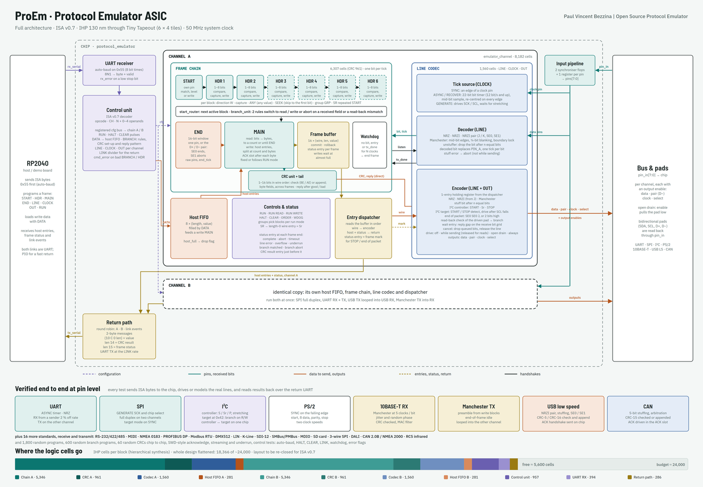

<!---
This file is used to generate the Tiny Tapeout datasheet page for ProEm.
Images must be under 512 kB each and 1 MB in total.
-->

## How it works

ProEm is a programmable protocol emulator. A host (the RP2040 on the Tiny Tapeout demo board, or any
UART) sends instruction bytes on `ui[0]`; the chip configures two independent channels, A and B, and
then sends and receives frames on the `uio` pins. Received data and a status byte for every frame go
back to the host on `uo[0]`.

Each channel is a frame chain (START, up to six headers, MAIN, END and a watchdog) behind a line
codec, so the same hardware speaks UART, SPI (controller and target), I2C (controller with clock
stretching, and target), PS/2, 10BASE-T receive (Manchester) and USB low speed (NRZI with bit
stuffing). Two `BRANCH` rules per channel let a frame change direction or abort on a field it has
just received, which gives I2C target mode, SWD-style acknowledge handling and CAN-style
arbitration. A CRC unit per channel checks or appends any CRC of 1 to 16 bits, and a reply pattern
answers a good frame on its own (USB ACK handshake, CAN acknowledge slot).

The host link auto-bauds: the first byte after reset must be `0x55`. Every instruction is one opcode
byte `{OP[3:0], CH, N[2:0]}` followed by 0 to 4 operand bytes. The full instruction set is in
`docs/protocol_emulator_isa.pdf`, and the design reference is `docs/protocol_emulator_design.pdf`.

| OP | Instruction | Operands |
| --- | --- | --- |
| 0x1, 0x2 | START, HDR n | `{W, CAP, GRP, CYC}`, `{SR, ANY, SEEK, -, PIN}`, `VALUE` |
| 0x3 | MAIN | `{DIR, WE, ACK, SR, PIN}`, `BITS[15:0]` |
| 0x4 | END | `{LEN, PIN_A}`, `{PAIR, INV, ERR, -, PIN_B}`, `PATTERN[15:0]` |
| 0x5 | WDOG | `LIMIT[15:0]` |
| 0x6 to 0x9 | ORDER, RUN, HALT, CLEAR | none |
| 0xA | LINE | `{CODE, INV, BND, PIN_A}`, `{SANY, STUFF, PIN_B}` |
| 0xB | CLOCK | `{SRC, EDGE, IDLE, PIN}`, `{ETK, DIV[21:16]}`, `DIV[15:0]` |
| 0xC | DATA | `VALUE` (length = N + 1) |
| 0xD | OUT | `{DRIVE, IDLE, PAIR, EOP, I2C, CSH, -}` |
| 0xE | LINK | return link clocks per bit (0 = same as the auto-baud rate) |
| 0xF | BRANCH | `N` = 0, 1: rule `{HIT, MISS, SRC, BLOCK}`, `MASK`, `VALUE`; `N` = 2: CRC `{WIDTH-1, FROM, INIT}`, `POLY[15:0]`; `N` = 3: `{ON, CHK, APP, INV, BYTE, SPAN, -}`, `RESIDUE[15:0]`; `N` = 4: reply `{WHEN, LEN-1, GAP}`, `PATTERN[15:0]` |

Return messages are two bytes: `{1, 0, C, 0, LEN}` then the value for received data on channel C,
`LEN = 14` for a CRC result (bit 0 good, bit 1 checked), `LEN = 15` for the end-of-frame status (bit 0 complete, 1 abort, 2 timeout, 3 line error,
4 overflow, 5 underrun, 6 branch matched, 7 branch abort), and `0xC0` for link events (bit 0 framing error, 1 bad instruction, 2 and 3 data
dropped on A or B).

The protocol pins are the eight `uio` pads, numbered 0 to 7 in the instructions. Channel A drives
pads 0 to 2 and channel B drives pads 3 to 5 when their `OUT` setting enables them; every pad is
always read back, which gives open-drain I2C and USB D+/D- on the same pins. Pads 6 and 7 are
inputs only.

## How to test

1. Reset the chip, then send `0x55` on `ui[0]` at 7 or more clocks per bit. `uo[1]`
   (BAUD_LOCKED) goes high.
2. UART loopback: connect `uio[3]` to `uio[0]`. Program channel A to receive (`LINE 0 pin 0`,
   `CLOCK ASYNC 16`, `START 0x00` of 1 bit, `MAIN` of 9 bits, `RUN`) and channel B to send
   (`LINE`, `CLOCK ASYNC 16`, `OUT` always, `START` write, `MAIN` write of 9 bits, `DATA 0x48`,
   `DATA 1`, `RUN`). The bytes come back on `uo[0]` as `{8, 0x48}`, `{1, 1}` and status `0x01`.
3. SPI loopback without any wiring except `uo[6]` to `uio[6]`: channel A generates SCK on pad 2 and
   MOSI on pad 0, and channel B samples pad 0 on the rising edge of pad 2 while pad 6 (A's chip
   select) is low.

4. I2C loopback: connect `uio[3]` to `uio[0]` with a pull-up on that wire and on `uio[2]`. Channel
   A is the controller (SCL on pad 2), channel B the target at 0x42 reading SDA on pad 0 and
   answering on pad 3.

All of these are in `test/test.py` (cocotb), which runs on the RTL and on the gate-level netlist.
The full pin-level test suite for every standard is in `sim/` (`scripts/run.sh`).

## External hardware

None required. For I2C add pull-up resistors on the pads you use for SDA and SCL. For USB low
speed as a device, add a 1.5 kOhm pull-up on D-. For 10BASE-T receive use an isolation
transformer and a comparator in front of the input pad.
