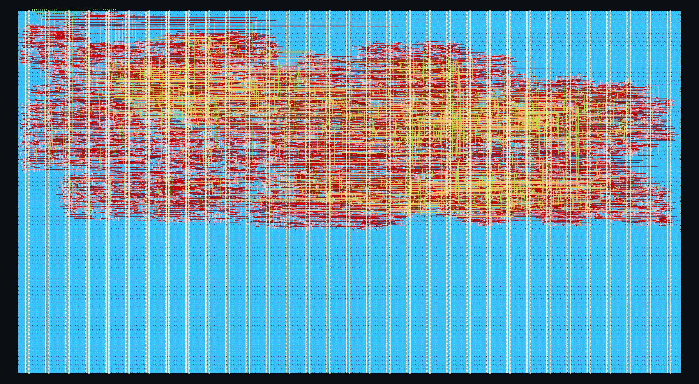
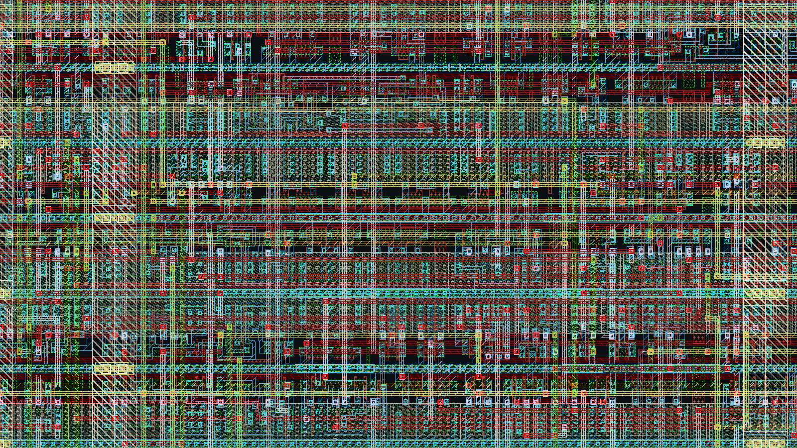
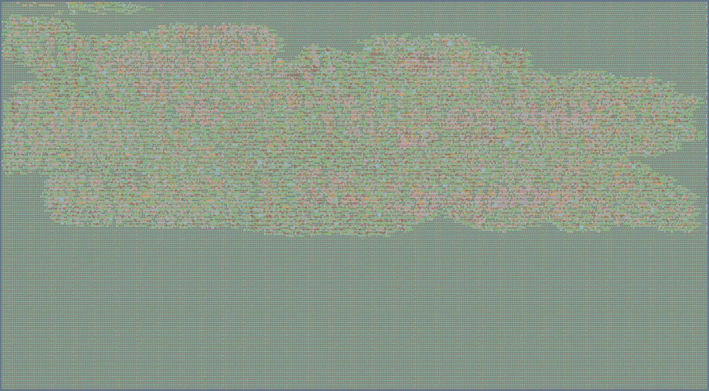

# ProEm layout (GDS) and results

This folder holds the finished layout of ProEm and the numbers behind it: how much space it
takes, how it relates to the Jane Street protocol emulator challenge, and its power and
performance.

| File | What it is |
| --- | --- |
| `tt_um_vertrex_star_proem.gds` | The layout (GDSII); open it in [KLayout](https://www.klayout.de/build.html) |
| `tt_um_vertrex_star_proem.lef` | The block's outline and pin positions |
| `images/` | Pictures of the layout (see [Images of the chip](#images-of-the-chip)) |

The layout was built on 27 September 2026 with the Tiny Tapeout flow (LibreLane 3.0.5) on the
IHP SG13G2 130 nm process, at 6 x 4 tiles and 50 MHz. It includes the branch unit, capture-any
headers, I2C target mode and DATA streaming (ISA v0.5). It is a reference build: the Jane
Street entry will be rebuilt on their CMOS5L template once they release it (see
[Jane Street challenge](#jane-street-challenge)). The chip has not been fabricated yet.

## Summary

| | |
| --- | --- |
| Top module | `tt_um_vertrex_star_proem` |
| Process | IHP SG13G2 130 nm (reference build) |
| Size | 6 x 4 Tiny Tapeout tiles; 1289.28 x 710.64 um |
| Logic | 15,513 cells after synthesis; 20,037 after place and route |
| Space used | 35 % of the core area; the lower third of the die is free |
| Clock | 50 MHz; timing met at every corner |
| Power | About 9 mW at 50 MHz |
| Checks | Magic DRC, KLayout DRC, LVS and the Tiny Tapeout precheck all pass |

## Space

| | |
| --- | --- |
| Die | 1289.28 x 710.64 um = 916,200 um² |
| Core (area available for cells) | 902,417 um² |
| Standard cells after place and route | 317,233 um² |
| Utilisation | 35 % |

Where the cell area goes:

| Cell class | Count | Area (um²) | Share |
| --- | ---: | ---: | ---: |
| Flip-flops | 2,406 | 117,867 | 37 % |
| Combinational logic | 12,275 | 125,302 | 40 % |
| Timing repair buffers (3,059 of them fix hold time) | 4,835 | 62,849 | 20 % |
| Clock tree | 301 | 6,592 | 2 % |
| Inverters, buffers, antenna diodes | 842 | 4,623 | 1 % |
| **Total** | **20,659** | **317,233** | **100 %** |

Main blocks (synthesis estimates):

| Block | Area (um²) |
| --- | ---: |
| One channel (frame chain, line codec, host FIFO, dispatcher) | 107,400 |
| Frame chain | 83,400 |
| Branch unit (two rules), inside the frame chain | 6,000 |
| Line codec | 15,800 |
| Control unit | 20,300 |
| UART receiver with auto-baud | 7,700 |
| Return path with UART transmitter | 5,300 |

The design no longer fits 6 x 2 tiles comfortably (it would need about 85 % utilisation), and
6 x 4 is the size the Jane Street challenge sets, so this build uses 6 x 4. About 60 % of the
die is still free for future additions.

## Jane Street challenge

The [Jane Street protocol emulator ASIC competition](https://blog.janestreet.com/protocol-emulator-asic-competition/)
(announced 10 September 2026; deadline 18 January 2027) asks for a chip that can speak real
protocols, built on IHP's CMOS5L process through Tiny Tapeout at 6 x 4 tiles.

| Challenge point | ProEm today |
| --- | --- |
| Required: UART, SPI, I2C | All three; SPI as controller and target; I2C as controller (with clock stretching) and as target |
| Stretch: low-speed USB | Receive and transmit, with bit stuffing and end of packet |
| Stretch: 10 Mbit Ethernet | Receive (Manchester decoded on chip); transmit needs a 40 or 60 MHz clock |
| Extra | PS/2; SWD-style acknowledge handling; CAN-style arbitration; two channels at once; auto-baud host link |
| Programmability | Frames described in instruction bytes, plus `BRANCH` rules that change a frame's direction or abort it from a received field or a read-back mismatch |
| Area: 6 x 4 tiles | Fits at 35 % utilisation |
| Process: CMOS5L | Same 84 standard cells as SG13G2, one fewer metal layer; no RTL change needed; rebuild once the template arrives |
| Full RTL to GDS with timing closure | Done on SG13G2 (this folder) |
| Verification | Pin-level tests for every standard; 1,800 random programs; 600 random branch programs; cocotb on RTL and gate level |

How it differs from the brief: the brief describes a tiny CPU running firmware. ProEm lets the
host describe a frame (START, headers, MAIN, END), does line coding (NRZI, Manchester, bit
stuffing, I2C conditions) in hardware, and reacts within a frame through two branch rules per
channel. Every bit has exact timing and both channels run in parallel. Still planned before
the deadline: formal proofs (SymbiYosys) on the FIFOs, frame buffer, UART and branch unit.

Jane Street pay to fabricate the winning designs, so the entry does not need a paid Tiny
Tapeout submission.

## Power

Estimated by OpenROAD on the routed layout with extracted wiring, at 50 MHz:

| Corner | Flip-flops | Logic | Clock tree | Total |
| --- | ---: | ---: | ---: | ---: |
| Typical: 1.20 V, 25 °C | 6.48 mW | 0.34 mW | 2.24 mW | **9.1 mW** |
| Slow: 1.08 V, 125 °C | 5.16 mW | 0.27 mW | 1.73 mW | 7.2 mW |
| Fast: 1.32 V, -40 °C | 7.89 mW | 0.43 mW | 2.94 mW | 11.3 mW |

* About 7.5 mA from the 1.2 V core supply; leakage is about 0.04 mW.
* About 96 % of the power is the clock reaching the 2,406 flip-flops; the logic itself uses
  about 4 %. Idle and busy power are therefore nearly the same.
* Heat: well under 1 °C of self-heating in a normal package; no cooling concerns.
* Power grid: worst voltage drop 0.48 mV on VPWR and 1.2 mV on VGND.
* This is a vectorless estimate (default switching rates). A vector-based estimate from the
  gate-level tests, or a current measurement on the real chip, would refine it.

## Performance

Timing after routing, with extracted wiring, at a 50 MHz (20 ns) clock:

| Corner | Setup slack | Hold slack | Maximum clock |
| --- | ---: | ---: | ---: |
| Typical: 1.20 V, 25 °C | 8.8 ns | 0.31 ns | 89 MHz |
| Slow: 1.08 V, 125 °C | 2.3 ns | 0.64 ns | 57 MHz |
| Fast: 1.32 V, -40 °C | 12.7 ns | 0.12 ns | 136 MHz |

0 setup and hold violations at every corner. The slow corner shows 9 slew warnings, each within
0.08 ns of the 2.5 ns limit; the flow reports them but does not treat them as errors. The
margin is smaller than in the earlier 6 x 2 build (5.9 ns) because the larger die spreads the
cells out.

Protocol speeds at 50 MHz:

| Standard | Speed |
| --- | --- |
| UART | Any common baud rate, up to a few Mbaud |
| SPI controller | SCK = 50 MHz / (2 x DIV); tested to 6.25 MHz |
| I2C controller | Tested from 1 MHz to 6.25 MHz SCL; covers 100 kHz, 400 kHz and 1 MHz modes |
| I2C target | Tested at 417 kHz and 1 MHz SCL |
| USB low speed | 1.5 Mbit/s |
| 10BASE-T | 10 Mbit/s receive |
| PS/2 | Full speed |
| CAN-style arbitration | Tested at 1 Mbit/s; needs at least 8 clocks per bit |

Host links: instructions in at up to about 7 Mbaud; results out at up to 12.5 Mbaud, which is
about 5 Mbit/s of returned data. `DATA` can stream while a frame runs; a fixed-timing line
keeps up when each entry lasts longer on the line than its 140 clocks on the instruction link
(UART to about 1.2 Mbaud when sent as byte, stop and start entries). Pad and pin multiplexer
speed limits for the shuttle have not been checked.

## Checks

| Check | Result |
| --- | --- |
| Verilator lint | 0 errors |
| Detailed routing | 0 violations |
| Antenna | 0 violations |
| Magic DRC | 0 errors |
| KLayout DRC (IHP SG13G2 rule deck) | 0 errors |
| LVS (layout matches the netlist) | Clean |
| Tiny Tapeout precheck | Passed |
| cocotb, gate level (routed netlist) | 4 of 4 passed |
| cocotb, RTL | 4 of 4 passed |

## Images of the chip

These are pictures of the finished layout that would be sent for fabrication; the chip itself
has not been made yet.

### Whole block

1289 x 711 um. Red and blue are the lower metal layers inside and between the cells; yellow and
green are the upper routing layers; the regular vertical stripes are the power straps. The logic
fills the upper part of the die; the plain area below is filler cells, free for future
additions.

### Close-up

About 40 x 22 um: rows of standard cells (3.78 um tall) with their internal wiring and the
routing above them.

### Tiny Tapeout style

The same layout rendered the way the Tiny Tapeout website shows projects.

## Viewing the GDS

1. Install KLayout from <https://www.klayout.de/build.html>.
2. File, Open, and choose `tt_um_vertrex_star_proem.gds`.
3. For IHP layer names and colours: File, Load Layer Properties, and choose `sg13g2.lyp` from
   `ihp-sg13g2/libs.tech/klayout/tech/` in the
   [IHP Open PDK](https://github.com/IHP-GmbH/IHP-Open-PDK).
4. Press `*` to show the inside of every cell.
