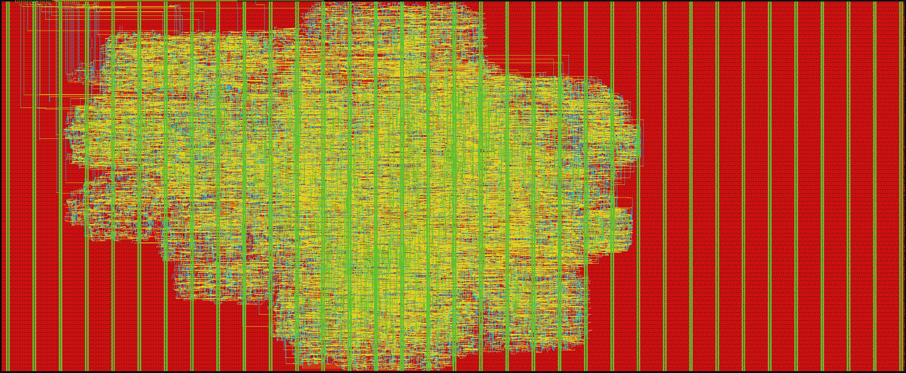
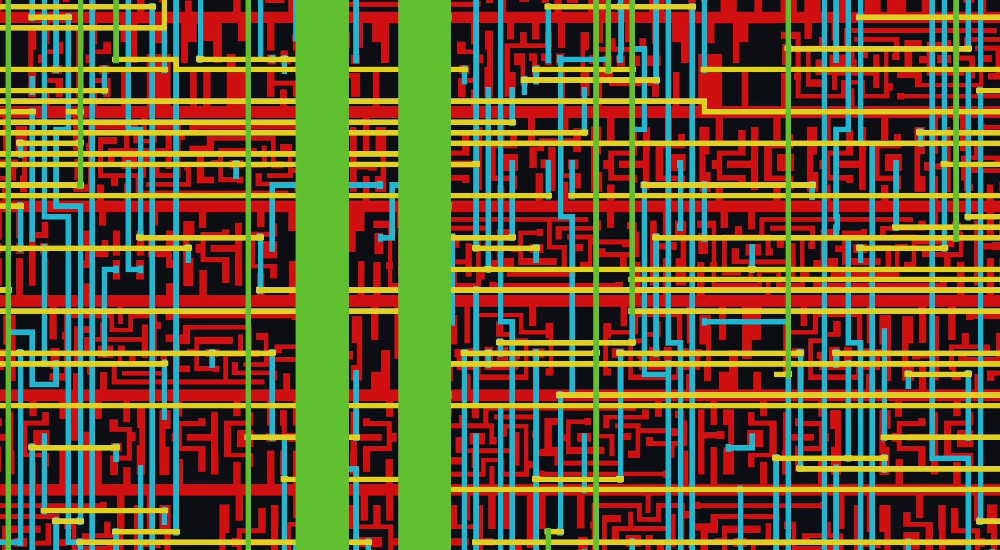
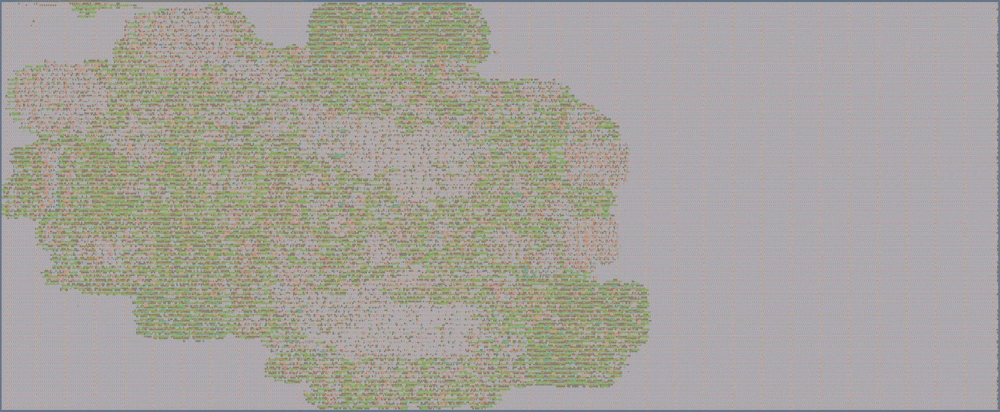

# ProEm layout (GDS) and results

This folder holds the layout of ProEm and the numbers behind it: how much space it takes, how it
relates to the Jane Street protocol emulator challenge, and its power and performance.

| File | What it is |
| --- | --- |
| `tt_um_vertrex_star_proem.gds` | The layout (GDSII); open it in [KLayout](https://www.klayout.de/build.html) |
| `tt_um_vertrex_star_proem.lef` | The block's outline and pin positions |
| `images/` | Pictures of the layout (see [Images of the chip](#images-of-the-chip)) |

## Current state: 8 x 4 tiles, ISA v0.7.2

This is the layout of ISA v0.7.2 on **8 x 4 tiles**, built by the `gds` GitHub workflow on
27 November 2026 (commit `9296536`) with the Tiny Tapeout CMOS5L flow (LibreLane
3.1.0.dev3, IHP-Open-PDK) on IHP SG13CMOS5L 130 nm at 50 MHz. Timing is met at all three corners,
routing, DRC, antenna and LVS are clean, and the gate-level cocotb tests pass on the routed
netlist. The chip has not been fabricated yet.

v0.7.2 is v0.7.1 plus the five corrections from the second verification round (range checks on
START, HDR and END lengths, a LINK divider taken per byte, auto-baud from 1 clock per bit, abort
winning over complete, and a branch abort keeping MAIN's last finished byte). This build also has the
host UART on the Tiny Tapeout UART pins (RX on `ui_in[3]`, TX on `uo_out[4]`), which the demo
board's RP2040 connects to its USB serial port; the logic is unchanged, only the pin map moved.

| | 8 x 4, v0.7.2 (27 November) | 6 x 4, v0.7.1 (14 October) |
| --- | --- | --- |
| Top module | `tt_um_vertrex_star_proem` | same |
| Process | IHP SG13CMOS5L 130 nm (Metal1 to Metal4 plus TopMetal1) | same |
| Die | 1724.16 x 710.64 um = 1,225,260 um² | 1289.28 x 710.64 um = 916,214 um² |
| Core (area available for cells) | 1,208,170 um² | 902,417 um² |
| Cells after synthesis | 19,417 (the flow's count) | 18,969 (a separate count, not like for like) |
| Cells after place and route | 26,069, not counting 76,327 fill cells | 25,612 |
| Utilisation | 32.4 % | 43 % |
| Clock | 50 MHz; met at every corner, 4.76 ns to spare at the slow corner | 50 MHz; met at every corner, 3.84 ns to spare |
| Power | 10.5 mW (typical corner) | 10.2 mW |
| Routing | 0 DRC violations after 6 iterations, 0 antenna violations (46 diodes), 1.01 m of wire | 0 violations, 1.15 m of wire |
| Checks | Magic DRC 0 errors, LVS clean, gate-level tests pass | Magic DRC 0 errors, LVS clean, precheck passed locally |

With a third more area the same logic spreads out more easily: the router needs 12 % less wire,
and the slow-corner margin grows from 3.84 ns to 4.76 ns.

Where the cell area went (8 x 4, v0.7.2):

| Cell class | Count | Area (um²) | Share |
| --- | ---: | ---: | ---: |
| Flip-flops | 2,785 | 136,434 | 35 % |
| Combinational logic | 15,765 | 163,055 | 42 % |
| Timing repair buffers (most of them fix hold time) | 6,185 | 79,264 | 20 % |
| Clock tree | 408 | 7,907 | 2 % |
| Inverters, buffers, antenna diodes | 926 | 5,080 | 1 % |
| **Total** | **26,069** | **391,740** | **100 %** |

The flow also reports max-slew warnings (163 pins at the typical corner, 1,081 at the slow corner)
and 202 max-fanout warnings. They are design-rule warnings,
not timing failures: timing analysis already includes the slow transitions and is met at every
corner, and the flow passes. The pins are on high-fanout nets, driven by the buffers the flow adds
to split fanout. The first edition did not record these counts for v0.7.1, so there is no
comparison; a tighter `MAX_FANOUT_CONSTRAINT` in `src/config.json` would reduce them if wanted.

To refresh this folder after another `gds` run: download the run's `tt_submission` artifact and
copy `tt_um_vertrex_star_proem.gds` and `.lef` from its `tt_submission/` folder here; the figures
are in `runs/wokwi/final/metrics.json` in the `GDS_logs` artifact.

## Jane Street challenge

The [Jane Street protocol emulator ASIC competition](https://blog.janestreet.com/protocol-emulator-asic-competition/)
(announced 10 September 2026; deadline 18 January 2027) asks for a chip that can speak real
protocols, built on IHP's CMOS5L process through Tiny Tapeout. The challenge originally set the
size at 6 x 4 tiles; the updated rules allow 8 x 4, which is the size ProEm uses from v0.7.2.
Entries start from the CMOS5L template, and the Tiny Tapeout GitHub Actions
build the GDS and run the precheck; a submission needs a passing GDS build.

| Challenge point | ProEm today |
| --- | --- |
| Required: UART, SPI, I2C | All three; SPI as controller and target; I2C as controller (with clock stretching) and as target |
| Stretch: low-speed USB | Receive and transmit, with bit stuffing and end of packet |
| Stretch: 10 Mbit Ethernet | Receive (Manchester decoded on chip); transmit needs a 40 or 60 MHz clock |
| Extra | PS/2; SWD-style acknowledge handling; CAN-style arbitration; two channels at once; auto-baud host link |
| Programmability | Frames described in instruction bytes, plus `BRANCH` rules that change a frame's direction or abort it from a received field or a read-back mismatch |
| Area | 8 x 4 tiles, as the updated rules allow; 32.4 % utilisation (v0.7.1 fitted the original 6 x 4 at 43 %) |
| Process: CMOS5L | Built on the CMOS5L template; the `gds` workflow uses the same flow |
| Full RTL to GDS with timing closure | Done: v0.7.2 at 8 x 4 meets timing at every corner, with DRC, antenna and LVS clean |
| Verification | Pin-level tests for every standard, including 16 more in `t_standards`; 1,800 random programs; 600 random branch programs; cocotb on RTL and gate level; a second simulator (Verilator) with 98 % line coverage; sigrok decoding of the standards waveforms; sixteen formal proofs covering every block, with mutation testing of each |

How it differs from the brief: the brief describes a tiny CPU running firmware. ProEm lets the
host describe a frame (START, headers, MAIN, END), does line coding (NRZI, Manchester, bit
stuffing, I2C conditions) in hardware, and reacts within a frame through two branch rules per
channel. Every bit has exact timing and both channels run in parallel.

Jane Street pay to fabricate the winning designs, so the entry does not need a paid Tiny
Tapeout submission.

## Power

Estimated by OpenROAD on the routed 8 x 4 layout, with extracted wiring, at 50 MHz.

| Corner | Flip-flops | Logic | Clock tree | Total |
| --- | ---: | ---: | ---: | ---: |
| Typical: 1.20 V, 25 °C | 7.50 mW | 0.31 mW | 2.66 mW | **10.5 mW** |
| Slow: 1.08 V, 125 °C | 5.98 mW | 0.25 mW | 2.04 mW | 8.3 mW |
| Fast: 1.32 V, -40 °C | 9.13 mW | 0.39 mW | 3.51 mW | 13.0 mW |

* About 8.7 mA from the 1.2 V core supply; leakage is about 0.05 mW.
* About 97 % of the power is the clock reaching the flip-flops; the logic itself uses about 3 %.
  Idle and busy power are therefore nearly the same.
* This is a vectorless estimate (default switching rates).
* v0.7.1 on 6 x 4 was 10.2 mW typical: the same flip-flops and clock, so nearly the same power.

## Performance

Timing after routing of the 8 x 4 layout, at a 50 MHz (20 ns) clock.

| Corner | Setup slack | Hold slack | Maximum clock |
| --- | ---: | ---: | ---: |
| Typical: 1.20 V, 25 °C | 10.4 ns | 0.26 ns | 104 MHz |
| Slow: 1.08 V, 125 °C | 4.76 ns | 0.59 ns | 66 MHz |
| Fast: 1.32 V, -40 °C | 12.9 ns | 0.07 ns | 140 MHz |

The CMOS5L flow only enforces the typical corner; this layout meets all three. v0.7.1 on 6 x 4
had 9.8, 3.8 and 12.4 ns of setup slack. How the slow corner was first closed is described in
[docs/verification_report.pdf](../docs/verification_report.pdf).

Protocol speeds at 50 MHz:

| Standard | Speed |
| --- | --- |
| UART | Any common baud rate, up to a few Mbaud |
| SPI controller | SCK = 50 MHz / (2 x DIV); tested to 6.25 MHz |
| I2C controller | Tested from 1 MHz to 6.25 MHz SCL; covers 100 kHz, 400 kHz and 1 MHz modes |
| I2C target | Tested at 417 kHz and 1 MHz SCL |
| USB low speed | 1.5 Mbit/s |
| 10BASE-T | 10 Mbit/s receive |
| PS/2 | Full speed |
| CAN-style arbitration | Tested at 1 Mbit/s; needs at least 8 clocks per bit |

Host links: instructions in at any rate from 1 clock per bit (v0.7.2) up; results out at up to
12.5 Mbaud (`LINK` 4), which is about 5 Mbit/s of returned data. `DATA` can stream while a frame
runs; a fixed-timing line keeps up when each entry lasts longer on the line than its time on the
instruction link. Pad and pin multiplexer speed limits for the shuttle have not been checked.

## Checks

| Check | v0.7.2, 8 x 4 | v0.7.1, 6 x 4 |
| --- | --- | --- |
| Verilator lint (`-Wall`) | Clean, with reviewed waivers | Clean |
| Pin-level suite (CXXRTL) | All pass, plus auto-baud at 1 clock per bit and the new `cmd_error` range checks | All pass |
| Formal proofs (SymbiYosys) | Sixteen, all proven; mutation testing in the verification report | Six |
| Detailed routing, antenna, DRC, LVS, timing | 0 violations; DRC 0 errors; LVS clean; timing met at every corner (`gds` job) | 0 violations; DRC 0 errors; LVS clean; timing met at every corner |
| cocotb, gate level | Passed on the routed netlist (`gl_test` job) | 6 of 6 passed |

## Images of the chip

### Whole block

1724 x 711 um, showing the routing metals only: red is Metal1 (with the cells' own wiring),
blue Metal2, yellow Metal3, green Metal4, and the regular bright green vertical stripes are the
TopMetal1 power straps. The logic sits on the left two thirds, close to where the Tiny Tapeout
pins come in; the rest of the core is filler.

### Close-up

About 40 x 22 um inside the logic: Metal1 underneath, the routing layers above it, and two
TopMetal1 power straps.

### Tiny Tapeout style

The same layout as rendered by the `gds` workflow (`gds_render` artifact), the way the Tiny
Tapeout website shows projects.

## Viewing the GDS

1. Install KLayout from <https://www.klayout.de/build.html>.
2. File, Open, and choose `tt_um_vertrex_star_proem.gds`.
3. For IHP layer names and colours: File, Load Layer Properties, and choose `sg13cmos5l.lyp` from
   `ihp-sg13cmos5l/libs.tech/klayout/tech/` in the
   [IHP Open PDK](https://github.com/IHP-GmbH/IHP-Open-PDK).
4. Press `*` to show the inside of every cell.
